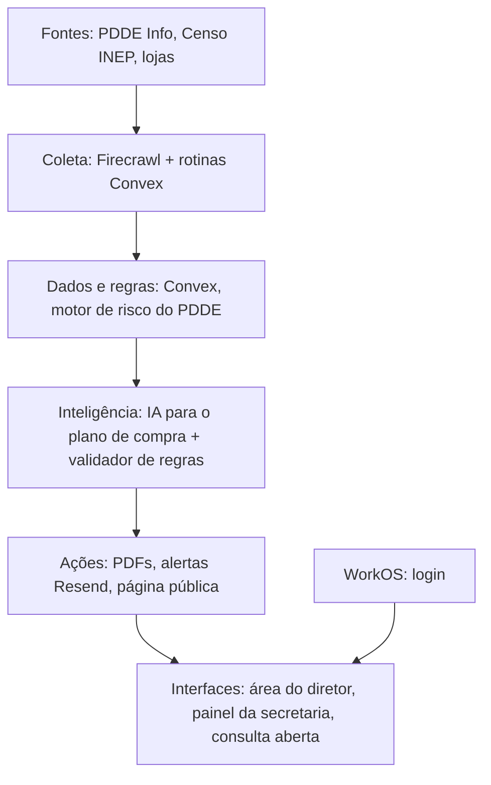

# Nenhuma escola perde o que já é dela

Plataforma que ajuda o diretor e a Unidade Executora (APM, caixa escolar) a planejar e gastar o dinheiro do **PDDE** antes que ele volte para o governo. O centro do produto é o **plano de compra**: a partir dos dados públicos do FNDE, ele mostra o que a escola pode comprar com o saldo que tem, com o prazo sempre visível no topo, e entrega os orçamentos e a ata prontos.

> Projeto do **Hack Brasil 2026** · Trilha **Acesso à educação**

## 🎯 O problema

* Escolas deixam o recurso do PDDE parado no banco por falta de tempo, medo de errar nas regras ou demora para juntar orçamentos.
* A partir de 2027, pela Resolução CD/FNDE 18/2025, o saldo do PDDE Básico precisa ser usado até o décimo dia útil de fevereiro do ano seguinte. O que sobrar volta para o governo, e o próximo repasse só cai em conta zerada.
* O governo já mostra o saldo, mas ninguém ajuda o diretor a transformar esse saldo em compra dentro do prazo.

## 💡 A solução

Um ciclo só: **detectar → decidir → executar → mostrar**.

| Etapa | O que a plataforma faz |
|---|---|
| Detectar | Saldo por conta, repasses e pendências de cada escola, coletados no PDDE Info |
| Decidir | Risco de estorno com contagem de dias úteis e plano de compra sugerido por IA, cruzando saldo, necessidades da escola (Censo Escolar) e regras do programa |
| Executar | Pesquisa de 3 preços por item, ata da Unidade Executora e consolidação de preços em PDF |
| Mostrar | Página pública da escola com o que recebeu, o que planejou e o que ainda está parado |

O plano de compra é a entrega principal, com um contador de dias até o prazo no topo. Alertas por e-mail avisam diretor e tesoureiro quando o prazo se aproxima ou surge uma pendência, e a secretaria recebe um resumo semanal da rede.

A prestação de contas continua no sistema oficial do FNDE. A plataforma cuida do que vem antes dela.

## ✨ Diferencial

* **Resolve, não só avisa:** o governo já mostra o saldo; nós entregamos o plano de compra, os preços e a ata.
* **Cada sugestão cita a regra** que a permite, com aprovação humana obrigatória.
* **Feito para o diretor:** linguagem simples e prazo sempre visível.
* **Consulta aberta:** qualquer escola vê sua situação pelo código INEP.

## 👥 Para quem

| Perfil | Uso |
|---|---|
| Diretor e Unidade Executora (APM, caixa escolar) | Alerta de prazo, plano de compra, preços e ata |
| Secretaria de educação | Painel da rede com escolas em risco e pendências |
| Pais e conselho escolar | Página pública com o que a escola recebeu e gastou |

Quem contrata é a **secretaria de educação**, com assinatura por escola. É ela que analisa as contas das escolas da rede, e pendência na prestação de contas suspende o repasse. Escolas e famílias não pagam.

## ⚙️ Como funciona

1. Rotinas agendadas coletam os dados do PDDE Info por rede, ou sob demanda na consulta aberta.
2. Os dados entram no banco com fonte e horário da coleta.
3. O motor de regras calcula o risco de estorno, os dias úteis até o prazo e as pendências.
4. A IA gera o plano de compra e um validador confere cada item contra as regras do PDDE.
5. O sistema busca preços e gera os documentos em PDF.
6. Alertas são enviados e a área do diretor, o painel e a página pública atualizam em tempo real.

## 🏗️ Arquitetura



## 🧰 Tecnologias

| Camada | Tecnologia |
|---|---|
| Frontend | Next.js, Tailwind CSS, shadcn/ui, Recharts |
| Backend e banco | Convex (dados em tempo real e rotinas agendadas) |
| Coleta de dados | Firecrawl |
| IA | LLM com saída estruturada e validação por regras |
| Documentos | React-PDF |
| Login | WorkOS |
| E-mail | Resend + React Email |
| Hospedagem | Vercel |
| Testes | Vitest e Playwright |

## 📊 Fontes de dados

* **PDDE Info (FNDE):** saldos, repasses e pendências por escola.
* **Censo Escolar e Catálogo de Escolas (INEP):** infraestrutura e dados de cada escola.
* **Lojas on-line:** preços para a pesquisa de três orçamentos.

Todo número exibido guarda a fonte e o momento da coleta.

## 🔒 Dados e privacidade

* Usamos apenas **dados institucionais e públicos** das escolas.
* Nenhum dado pessoal de alunos, diretores ou responsáveis é exibido.
* Chaves e segredos ficam em variáveis de ambiente, fora do repositório.

## 🚀 Como rodar

**Pré-requisitos:** Node.js 20+ e pnpm.

```bash
git clone https://github.com/JoaoBreganon/Hack-Brasil.git
cd Hack-Brasil
pnpm install
cp .env.example .env.local
pnpm dev
```

**Variáveis de ambiente**

```env
CONVEX_DEPLOYMENT=
NEXT_PUBLIC_CONVEX_URL=
FIRECRAWL_API_KEY=
RESEND_API_KEY=
WORKOS_API_KEY=
WORKOS_CLIENT_ID=
LLM_API_KEY=
```

## 🗂️ Estrutura

```
apps/web/        Next.js: área do diretor, painel da secretaria, consulta aberta
convex/          banco, regras de risco e rotinas agendadas
packages/pdf/    modelos de ata, consolidação de preços e checklist da compra
```

## 🏆 Hack Brasil 2026

* **Trilha:** Acesso à educação
* **Demo:** `<link da demo>`
* **Vídeo:** `<link do vídeo>`

## 📄 Licença

Este projeto **não é open source**. O código é distribuído sob a **Business Source License 1.1**, com permissão adicional para que jurados, mentores e organizadores do Hack Brasil possam **ler, executar e testar** todo o código para fins de avaliação. Uso em produção ou comercial exige autorização escrita do time. Veja o arquivo `LICENSE`.

## 👩‍💻 Time

* Guilherme Carvalho Mais
* Gabriel Duarte Frias
* João Gabriel Breganon Ferreira