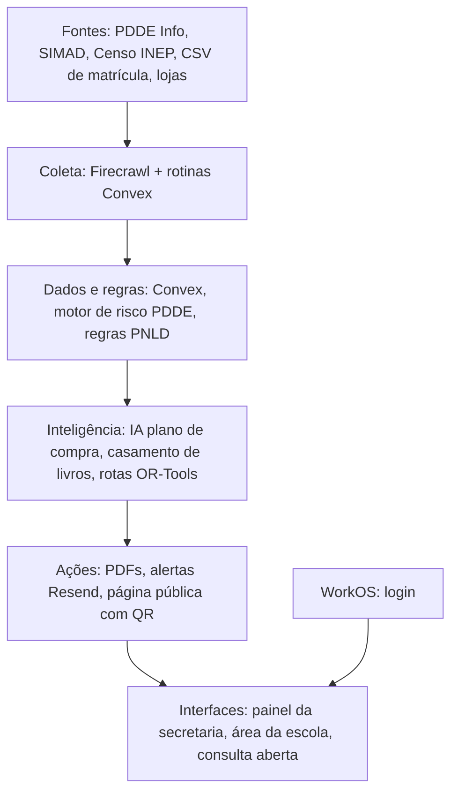

# Nenhuma escola perde o que já é dela

Plataforma que faz o dinheiro do **PDDE** e os livros do **PNLD** chegarem ao aluno. Ela confere todos os dias os sistemas públicos do FNDE, aponta onde há dinheiro parado, pendência ou livro sobrando e faltando, e entrega a solução pronta.

> Projeto do **Hack Brasil 2026** · Trilha **Acesso à educação**

## 🎯 O problema

**Dinheiro (PDDE)**
* Escolas deixam o recurso parado no banco por falta de orientação, tempo ou documentação.
* Pela regra nova do FNDE, o saldo do PDDE Básico não usado no prazo anual volta para o governo, e o próximo repasse só cai em conta zerada.
* Pendências cadastrais e de prestação de contas bloqueiam o repasse.

**Livros (PNLD)**
* A distribuição usa números antigos do Censo Escolar, então sobra livro em uma escola e falta em outra.
* O remanejamento oficial depende de cada escola lançar sobras à mão, e o transporte fica por conta da rede.

## 💡 A solução

Dois módulos com o mesmo ciclo: **detectar → decidir → executar → prestar contas**.

| Etapa | 💰 Dinheiro (PDDE) | 📚 Livros (PNLD) |
|---|---|---|
| Detectar | Saldos, repasses e pendências de cada escola | O que cada escola recebeu, por título e ano |
| Decidir | Risco de estorno e plano de compra sugerido por IA, cruzando saldo, necessidades da escola e regras do programa | Sobra e falta pela matrícula atual, casando escolas que usam a mesma obra |
| Executar | Pesquisa de 3 preços, ata e consolidação de preços em PDF | Rota da van, ordem das paradas e guia de remessa em PDF |
| Prestar contas | Página pública da escola com QR code | Registro das entregas e alunos atendidos |

Alertas por e-mail avisam secretaria e escolas quando surge pendência ou um prazo se aproxima.

## ✨ Diferencial

* **Resolve, não só avisa:** entrega compra planejada, preços, documentos e logística.
* **Dinheiro e livros no mesmo lugar.**
* **Estimativa automática de livros,** sem depender de lançamento manual.
* **Cada sugestão cita a regra** que a permite, com aprovação humana obrigatória.
* **Consulta aberta:** qualquer escola vê sua situação pelo código INEP.

## 👥 Para quem

| Perfil | Uso |
|---|---|
| Secretaria de educação | Painel da rede, riscos, pendências e remanejamento |
| Diretor e Unidade Executora (APM, caixa escolar) | Plano de compra, preços e documentos |
| Logística da rede | Rotas e guias de remessa |
| Pais e conselho escolar | Página pública com o que a escola recebeu e gastou |

Quem contrata é a **secretaria municipal de educação**, com assinatura por escola. Escolas e famílias não pagam.

## ⚙️ Como funciona

1. Rotinas agendadas coletam dados do PDDE Info e do SIMAD por rede, ou sob demanda na consulta aberta.
2. Os dados entram no banco com fonte e horário da coleta.
3. O motor de regras calcula risco de estorno, pendências e sobra ou falta de livros.
4. A IA gera o plano de compra e um validador confere cada item contra as regras do PDDE.
5. O sistema busca preços e gera os documentos em PDF.
6. O otimizador calcula a rota de remanejamento e gera as guias.
7. Alertas são enviados e painel e página pública atualizam em tempo real.

## 🏗️ Arquitetura



## 🧰 Tecnologias

| Camada | Tecnologia |
|---|---|
| Frontend | Next.js, Tailwind CSS, shadcn/ui, MapLibre, Recharts |
| Backend e banco | Convex (dados em tempo real e rotinas agendadas) |
| Coleta de dados | Firecrawl |
| IA | LLM com saída estruturada e validação por regras |
| Rotas | Google OR-Tools (serviço Python) |
| Documentos | React-PDF |
| Login | WorkOS |
| E-mail | Resend + React Email |
| Hospedagem | Vercel (web) e Cloud Run (serviço de rotas) |
| Testes | Vitest e Playwright |

## 📊 Fontes de dados

* **PDDE Info (FNDE):** saldos, repasses e pendências por escola.
* **SIMAD (FNDE):** distribuição de livros do PNLD por escola.
* **Censo Escolar e Catálogo de Escolas (INEP):** infraestrutura, matrícula e localização.
* **Secretaria cliente:** matrícula atual em CSV.

Todo número exibido guarda a fonte e o momento da coleta.

## 🔒 Dados e privacidade

* Usamos apenas **dados institucionais e públicos** das escolas.
* Nenhum dado pessoal de alunos, diretores ou responsáveis é exibido.
* Chaves e segredos ficam em variáveis de ambiente, fora do repositório.

## 🚀 Como rodar

**Pré-requisitos:** Node.js 20+, pnpm e Python 3.11+ (serviço de rotas).

```bash
git clone https://github.com/JoaoBreganon/Hack-Brasil.git
cd Hack-Brasil
pnpm install
cp .env.example .env.local
pnpm dev
```

**Variáveis de ambiente**

```env
CONVEX_DEPLOYMENT=
NEXT_PUBLIC_CONVEX_URL=
FIRECRAWL_API_KEY=
RESEND_API_KEY=
WORKOS_API_KEY=
WORKOS_CLIENT_ID=
LLM_API_KEY=
ROUTING_SERVICE_URL=
```

**Serviço de rotas**

```bash
cd services/routing
pip install -r requirements.txt
uvicorn main:app --reload
```

## 🗂️ Estrutura

```
apps/web/            Next.js: painel, área da escola, consulta aberta
convex/              banco, regras de risco e rotinas agendadas
services/routing/    otimização de rotas (Python + OR-Tools)
packages/pdf/        modelos de ata, preços e guia de remessa
```

## 🏆 Hack Brasil 2026

* **Trilha:** Acesso à educação
* **Demo:** `<link da demo>`
* **Vídeo:** `<link do vídeo>`

## 📄 Licença

Este projeto **não é open source**. O código é distribuído sob a **Business Source License 1.1**, com permissão adicional para que jurados, mentores e organizadores do Hack Brasil possam **ler, executar e testar** todo o código para fins de avaliação. Uso em produção ou comercial exige autorização escrita do time. Veja o arquivo `LICENSE`.

## 👩‍💻 Time

* Guilherme Carvalho Mais
* Gabriel Duarte Frias
* João Gabriel Breganon Ferreira
